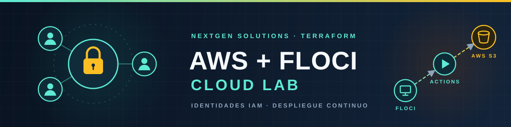

<div align="center">


<br>
  
  
  
  
  
  
<br>
  <a href="https://github.com/DavidTorro/aws-iam-governance-lab/actions/workflows/ci.yml">
    
  </a>
  <a href="https://github.com/DavidTorro/aws-iam-governance-lab/actions/workflows/web.yml">
    
  </a>
  <a href="https://davidtorro.github.io/aws-iam-governance-lab/">
    
  </a>
  <a href="https://davidtorro.github.io/aws-iam-governance-lab/pdf/aws-iam-governance-lab.pdf">
    
  </a>
  <a href="https://github.com/DavidTorro">
    
  </a>

</div>

# AWS IAM Governance Lab

Práctica de NextGen Solutions en dos partes, resuelta como **infraestructura como código con Terraform** y siguiendo la organización de [aws-iam-security-lab](https://github.com/DavidTorro/aws-iam-security-lab):

- **Parte 1 · IAM**: gobernanza de identidades en el emulador local [Floci](https://floci.io/). El simulador IAM verifica los permisos y se comprueba el carácter efímero del entorno.
- **Parte 2 · Despliegue**: la web de la empresa se publica en S3. Cada cambio se prueba primero en Floci y GitHub Actions solo lo despliega en AWS Learner Lab si la prueba pasa.

## Resultado de la Parte 1

| Grupo | Usuarios | Permisos principales |
| --- | --- | --- |
| Dev-Team | `roberto`, `sandra`, `alicia` | Lectura S3, operaciones de datos DynamoDB y denegación explícita de borrado S3 |
| Ops-Team | `marta`, `alexis` | Consulta, arranque y parada EC2; gestión Lambda |
| SecOps-Team | `camila`, `alicia` | Lectura CloudTrail, CloudWatch Logs e IAM; denegación de operaciones destructivas |

Las políticas están asociadas **solo a los grupos**. La [verificación real](./evidence/verification.md) comprobó las siete pertenencias, la ausencia de políticas directas y 23 decisiones del simulador para cuatro usuarios. El [estado Terraform](./evidence/terraform-state.txt) registra los 18 recursos gestionados. `s3:DeleteObject` para `alicia` devolvió `explicitDeny`. La [prueba de reinicio](./evidence/ephemeral.json) confirmó que, sin persistencia, los seis usuarios desaparecen al parar y arrancar Floci.

## Resultado de la Parte 2

| Entorno | Resultado |
| --- | --- |
| Floci | La web responde 200 con el nombre `nextgen` y sin permiso público |
| AWS | `BucketAlreadyExists` con `nextgen`, 403 sin política pública y OK con `nextgen-david-torro` y `public_read = true` |
| GitHub Actions | Un cambio correcto llega solo a producción; un commit sin `index.html` falla en Floci y el despliegue en AWS no se ejecuta |

El módulo [`modules/s3-website`](./modules/s3-website) es el mismo en los tres sitios; [`envs/web-floci`](./envs/web-floci) y [`envs/web-aws`](./envs/web-aws) solo cambian el endpoint, las credenciales y el estado. En Learner Lab una SCP impide usar `aws_s3_bucket`, por lo que el bucket lo crea [`scripts/web-deploy.sh`](./scripts/web-deploy.sh). Los logs reales y las ejecuciones de Actions están en [`evidence/parte2`](./evidence/parte2).

## Requisitos y ejecución

Necesitas Terraform ≥ 1.9, Docker en funcionamiento, AWS CLI, Floci CLI y Python 3. Floci se puede instalar en macOS con `brew install floci-io/floci/floci`; consulta las [instrucciones oficiales](https://floci.io/) para otros sistemas. **El proveedor Terraform y los scripts dirigen todas las llamadas AWS a `http://localhost:4566` con credenciales ficticias.**

Si Floci ya está en marcha, omite `floci start`.

```bash
floci start
bash scripts/deploy.sh
python3 scripts/verify.py
```

`deploy.sh` ejecuta `terraform init` y `terraform apply` en [`envs/floci`](./envs/floci). La configuración usa el módulo [`modules/iam-group`](./modules/iam-group) para crear cada grupo y su política inline, y gestiona los seis usuarios y sus pertenencias con recursos Terraform. El estado local `terraform.tfstate` está ignorado por Git; el lockfile del proveedor sí se conserva. `verify.py` consulta Floci con AWS CLI y falla si una pertenencia, política o decisión difiere de lo esperado. Escribe las respuestas originales en `evidence/verification.json` y un resumen en `evidence/verification.md`.

Para revisar la infraestructura antes de aplicarla:

```bash
terraform -chdir=envs/floci init
terraform -chdir=envs/floci validate
terraform -chdir=envs/floci test
terraform -chdir=envs/floci plan
terraform -chdir=envs/floci apply
```

La prueba de infraestructura efímera elimina las identidades del emulador:

```bash
bash scripts/check-ephemeral.sh
cat evidence/ephemeral.json
```

Para la web de la Parte 2, `config/web.tfvars` define el nombre del bucket y si es pública. AWS necesita las credenciales de Learner Lab en `~/.aws/credentials`, y GitHub Actions las toma del secret `AWS_CREDENTIALS`:

```bash
bash scripts/web-deploy.sh floci
bash scripts/web-deploy.sh aws
bash scripts/web-deploy.sh aws destroy
```

Después, `bash scripts/deploy.sh` detecta el estado vacío de Floci y reconstruye los recursos desde Terraform. Para comprobar manualmente a `alicia`:

```bash
eval "$(floci env)"
aws iam list-groups-for-user --user-name alicia
arn="$(aws iam get-user --user-name alicia --query User.Arn --output text)"
aws iam simulate-principal-policy --policy-source-arn "$arn" \
  --action-names s3:GetObject s3:DeleteObject cloudtrail:LookupEvents \
  --query 'EvaluationResults[].[EvalActionName,EvalDecision]' --output table
```

## Memoria y PDF

La [memoria técnica](./docs/index.md) explica los bloques JSON, la denegación explícita, la gobernanza por grupos, las simulaciones y la prueba de entorno efímero. En la Parte 2 recoge las fases del despliegue con sus capturas, la comparativa Floci/AWS y las respuestas sobre los límites del emulador, CI/CD y la gestión de secretos. Incluye imágenes de las políticas y de las respuestas del simulador, generadas a partir de los archivos y datos reales con `python3 scripts/render-evidence.py` (requiere ImageMagick en macOS).

```bash
python3 -m venv .venv
.venv/bin/pip install -r requirements.txt
.venv/bin/mkdocs build --strict
ENABLE_PDF_EXPORT=1 .venv/bin/mkdocs build --strict
```

El PDF generado queda en `site/pdf/aws-iam-governance-lab.pdf`; la [copia final de la memoria](./output/pdf/aws-iam-governance-lab.pdf) se incluye en el repositorio. GitHub Actions valida Terraform, las políticas y la documentación; `Web` prueba y despliega la web, y el despliegue de Pages se ejecuta manualmente desde `Documentación`.

## Estructura

```text
policies/                 Políticas JSON de los tres grupos
modules/iam-group/        Módulo Terraform para grupo y política
envs/floci/               Despliegue IAM en Floci, lockfile y test
web/                      Web de NextGen Solutions (Parte 2)
config/web.tfvars         Nombre del bucket y lectura pública
modules/s3-website/       Módulo Terraform del sitio web S3 y sus tests
envs/web-floci/           Web en Floci (estado local)
envs/web-aws/             Web en AWS (estado remoto en S3)
scripts/                  Wrappers de Terraform, verificación y prueba de reinicio
evidence/                 Respuestas reales de Floci, AWS y GitHub Actions
docs/                     Memoria y capturas
pdf/                      Plantilla y estilos del PDF
.github/                  CI, despliegue de la web y de la documentación
enunciados/               Enunciado original, conservado solo en local
```

El enunciado del profesorado no se publica. Código y documentación propios bajo [MIT](LICENSE).
