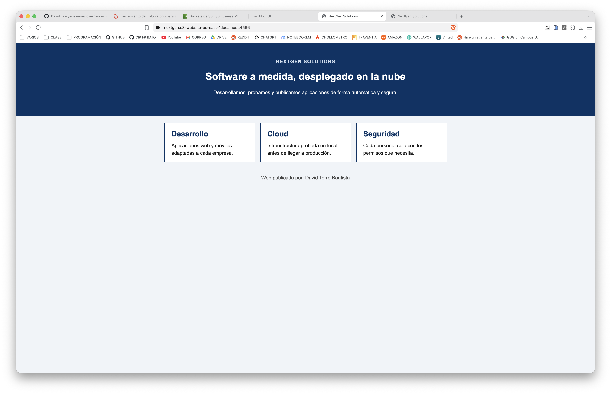
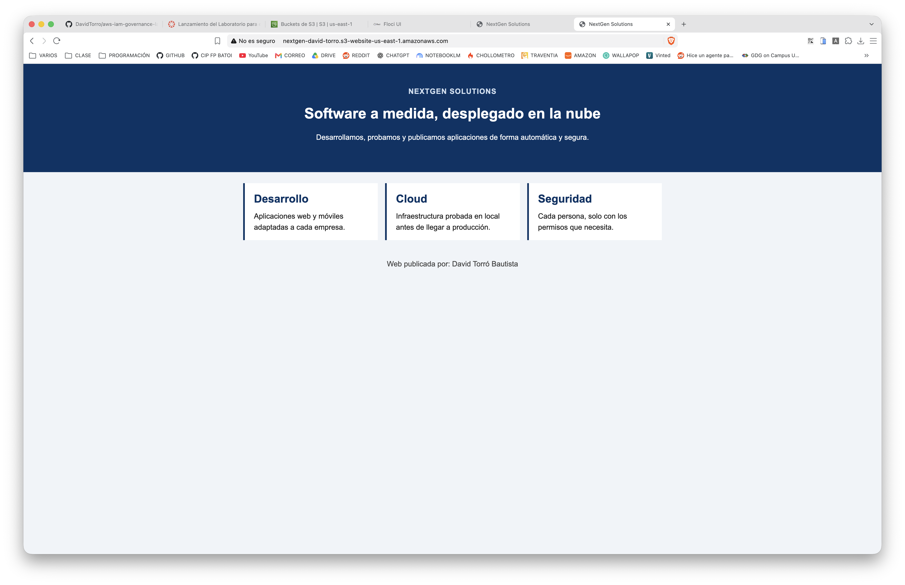
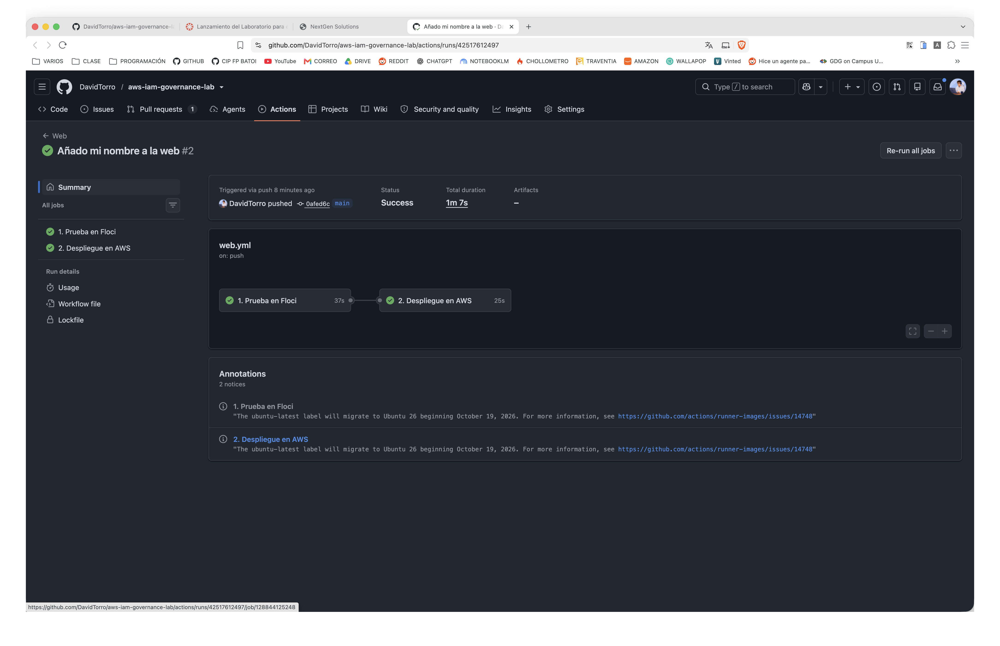
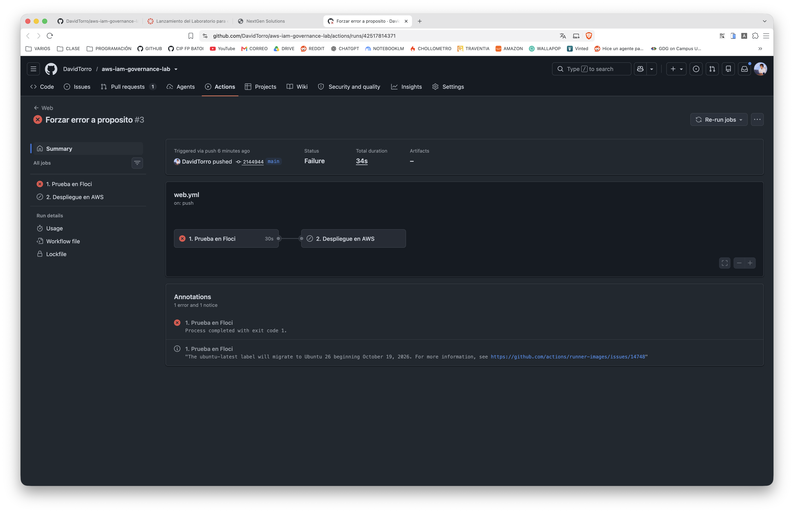

# Ejecución por fases

Todas las salidas proceden de ejecuciones reales del 8 de noviembre de 2026. Los logs completos están en [`evidence/parte2/`](https://github.com/DavidTorro/aws-floci-cloud-lab/tree/main/evidence/parte2). En los errores de AWS se han ocultado los identificadores de cuenta y de organización.

## Fase 1: la web en el PC

Con `bucket_name = "nextgen"` y `public_read = false`:

```bash
floci start
bash scripts/web-deploy.sh floci
```

```text
== Destino: FLOCI (http://localhost:4566) ==
Bucket: nextgen
make_bucket: nextgen
Apply complete! Resources: 5 added, 0 changed, 0 destroyed.
OK. Tu web está en: http://nextgen.s3-website-us-east-1.localhost:4566/
```

Terraform creó la configuración de sitio web, el bloqueo de acceso público y los tres archivos. Un segundo `terraform plan` no detectó cambios. La web respondió 200 aunque era privada y tenía bloqueado el acceso público. La misma dirección no carga en el móvil: `localhost` significa «este mismo dispositivo» y Floci solo existe en el PC.



## Fase 2: el salto a AWS

Con las credenciales de Learner Lab en `~/.aws/credentials`, se lanzó exactamente el mismo script contra AWS:

```bash
bash scripts/web-deploy.sh aws
```

**Error 1: el nombre ya existe.** Con `bucket_name = "nextgen"`:

```text
make_bucket failed: s3://nextgen An error occurred (BucketAlreadyExists) when calling
the CreateBucket operation: The requested bucket name is not available. The bucket
namespace is shared by all users of the system. Please select a different name and try again.
```

**Error 2: la web es privada.** Con `bucket_name = "nextgen-david-torro"`, Terraform aplicó los cambios sin errores, pero la comprobación HTTP falló:

```text
Apply complete! Resources: 5 added, 0 changed, 0 destroyed.
Comprobando que la web responde...
ERROR: la web responde con el código 403 (se esperaba 200).
```

**Solución.** Con `public_read = true`, Terraform relajó el bloqueo de políticas públicas y añadió la política `LecturaPublica` (`s3:GetObject` para `*`). Las ACL públicas siguen bloqueadas.

```text
Plan: 1 to add, 1 to change, 0 to destroy.
Apply complete! Resources: 1 added, 1 changed, 0 destroyed.
OK. Tu web está en: http://nextgen-david-torro.s3-website-us-east-1.amazonaws.com/
```



## Fase 3: automatizar con GitHub

Se guardó el bloque de credenciales de Learner Lab como secret `AWS_CREDENTIALS` del repositorio. El código entró en `main` con la [PR #5](https://github.com/DavidTorro/aws-floci-cloud-lab/pull/5), y ese merge lanzó el workflow `Web`.

Los dos primeros intentos del trabajo de AWS fallaron con `AccessDenied … policy/voc-cancel-cred`. El laboratorio estaba parado, y Learner Lab asigna esa política al rol para denegarlo todo. Tras pulsar *Start Lab* y actualizar el secret, el tercer intento terminó en verde. El trabajo de AWS encontró el estado remoto creado en la Fase 2 y solo actualizó `index.html`:

```text
1. Prueba en Floci    Apply complete! Resources: 6 added, 0 changed, 0 destroyed.
2. Despliegue en AWS  Apply complete! Resources: 0 added, 1 changed, 0 destroyed.
```

Nadie tocó la nube a mano. GitHub creó un equipo temporal, arrancó un Floci vacío, probó la web y después ejecutó el mismo módulo contra AWS con el secret.

## Fase 4: cambiar y romper

**Un cambio correcto llega solo a producción.** El commit `0afed6c` sustituyó «ESCRIBE AQUÍ TU NOMBRE» por el nombre del autor. Los dos trabajos terminaron en verde y la web pública mostró el cambio.



**Un cambio erróneo no llega a producción.** El commit `2144944` renombró `web/index.html` a `web/inicio.html`. La prueba en Floci se detuvo en el `plan`:

```text
Error: Invalid value for variable
La web no tiene portada: falta index.html.
```

El despliegue en AWS quedó en `skipped` y la web pública siguió mostrando la versión anterior. El workflow `CI` falló en el mismo commit, porque los tests del módulo también comprueban la carpeta `web/`. El commit `02c17f6` revirtió el error y los dos trabajos volvieron a terminar en verde.



| Commit | Prueba en Floci | Despliegue en AWS |
| --- | --- | --- |
| `344908a` Merge de la PR #5 | ✅ | ✅ (intento 3) |
| `0afed6c` Añado mi nombre | ✅ | ✅ |
| `2144944` Error a propósito | ❌ | ⏭️ sin ejecutar |
| `02c17f6` Revert | ✅ | ✅ |

El detalle de cada ejecución está en [`evidence/parte2/actions.md`](https://github.com/DavidTorro/aws-floci-cloud-lab/blob/main/evidence/parte2/actions.md).

## Limpieza

```bash
bash scripts/web-deploy.sh aws destroy
floci stop
```

`destroy` elimina con Terraform la política, el bloqueo de acceso público, la configuración de sitio web y los archivos, y después borra el bucket con `aws s3 rb --force`. El bucket del estado remoto se borra al final a mano. Por último se pulsa *End Lab* en Learner Lab.
